<p align="center"></p>

<p align="center">
  <a href="https://too-easy-seven.vercel.app"></a>
  
  
</p>

## What it is

**TOO EASY** is a streetwear label built as an exercise in restraint. Five pieces, shot and priced like a real drop: a jersey, a puffer jacket, sneakers, sunglasses and track pants. The product grid carries the whole page. There is no manifesto and no lifestyle campaign.

**In plain English:** a shop page that trusts the clothes to do the talking.

## How it is built

- One `index.html` with its own CSS, set in Inter. No framework, no build step, nothing to install.
- Product photography lives in `images/`.
- Deployed as a static site on Vercel.

## Run it

```bash
# open index.html in a browser, or serve the folder
npx serve .
```

<p align="center"></p>

<p align="center"><sub>Built by <a href="https://github.com/sameermotwani17-cell">Sameer Motwani</a> · <a href="https://portfolio-sameermotwani17-cells-projects.vercel.app">portfolio</a></sub></p>
